# Active Directory Home Lab

A single-domain Windows lab built in VirtualBox to practise core identity and access administration: user lifecycle, Group Policy, PowerShell automation and basic security monitoring.

## Environment

| Machine | OS | Role | IP address |
|---|---|---|---|
| DC01 | Windows Server 2025 Standard (evaluation) | Domain controller, DNS | 10.10.10.10 |
| WS01 | Windows 11 Enterprise (evaluation) | Domain-joined workstation | 10.10.10.20 |

- **Domain:** `lab.internal` (NetBIOS `LAB`), Windows Server 2025 functional level
- **Network:** VirtualBox NAT Network `10.10.10.0/24`, static addressing, gateway `10.10.10.1`
- **DNS:** AD-integrated on DC01, with a forwarder to `8.8.8.8` for internet resolution
- **Host:** Windows 11 Pro laptop, 16 GB RAM, VirtualBox 7.2

## What I built

1. **Domain controller.** Installed the AD DS role on DC01 and promoted it to a new forest with integrated DNS. Verified the domain, the DC's A record and the `_ldap._tcp.dc._msdcs` SRV record that clients use to locate a domain controller.
2. **Domain join.** Pointed WS01's DNS at the DC, confirmed name resolution and LDAP connectivity (`Test-NetConnection -Port 389`), then joined it to the domain.
3. **Directory structure.** Created OUs for `Staff`, `Workstations` and `Groups`, user accounts, and a global security group `SG-Finance`. Moved WS01 into the Workstations OU so OU-linked policies apply to it.
4. **Helpdesk tasks.** Reset a password, forced a password change at next logon, and unlocked a locked-out account.
5. **Group Policy.**
   - Domain-level password and lockout policy in the Default Domain Policy (12-character minimum, complexity, history of 24, lockout after 5 failed attempts).
   - OU-level GPO `Staff - Desktop Restrictions` blocking Control Panel and PC settings for Staff users.
   - Verified application on the client with `gpupdate /force` and `gpresult /r`.
6. **PowerShell automation.** Wrote [`New-LabUsers.ps1`](scripts/New-LabUsers.ps1), which bulk-creates users from [`users.csv`](data/users.csv), places them in the right OU, adds Finance staff to `SG-Finance`, and forces a password change at first logon.

## The PowerShell script

The script:

- reads the initial password at run time with `Read-Host -AsSecureString`, so no password is stored in the script or the CSV
- checks whether each account exists first, so it is safe to run more than once
- uses splatting (`New-ADUser @params`) to keep the long command readable
- derives the domain path from `Get-ADDomain` instead of hard-coding it

Example run and verification:

```powershell
.\New-LabUsers.ps1
Get-ADUser -Filter * -SearchBase "OU=Staff,DC=lab,DC=internal" -Properties Department |
    Select-Object Name, SamAccountName, Department
```

## Security observations

After enforcing the lockout policy, I triggered a lockout with repeated failed sign-ins on WS01 and traced it in the logs:

- **Event 4625** (failed logon) on WS01
- **Event 4740** (account locked out) in the DC's Security log

I then located the account with `Search-ADAccount -LockedOut` and unlocked it.

## Problems I solved along the way

- **VM wizard failed silently.** VirtualBox's New VM wizard did nothing on Finish in expert mode. Switching to the step-by-step basic wizard worked.
- **Black screen at boot.** VirtualBox was running on the Windows hypervisor ("Native API" execution engine) rather than directly on VT-x, which broke UEFI boot. Fixed by booting DC01 in BIOS mode, and for WS01 (which requires UEFI) by switching the graphics controller to VMSVGA and disabling Secure Boot in the VM.
- **Missing domain A record.** `lab.internal` returned only an SOA record after promotion. Re-registering with `ipconfig /registerdns` and restarting the Netlogon service created it.

## What I'd do next

- Add a second domain controller for redundancy and test replication
- Apply fine-grained password policies with stricter rules for admin accounts
- Forward Security logs to a free SIEM and build alerts for lockouts and failed logons
- Create tiered admin accounts and remove day-to-day use of the built-in Administrator

## Screenshots

### DC01 setup
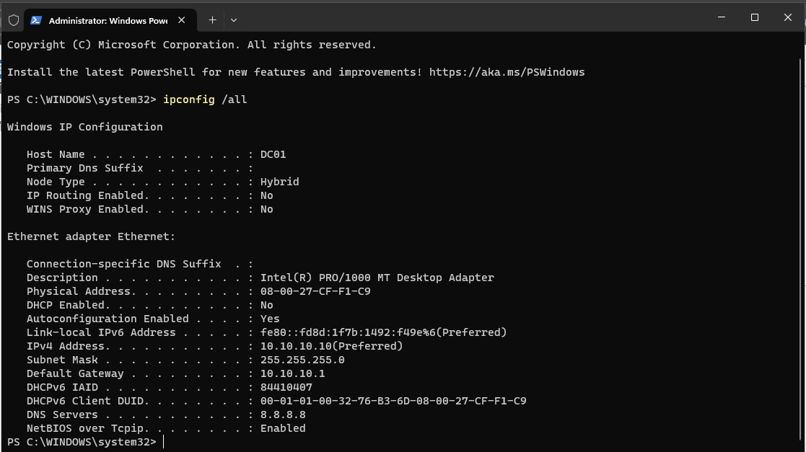
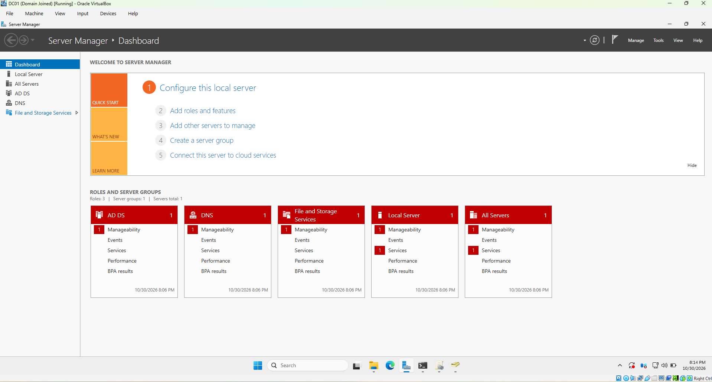

### Domain join
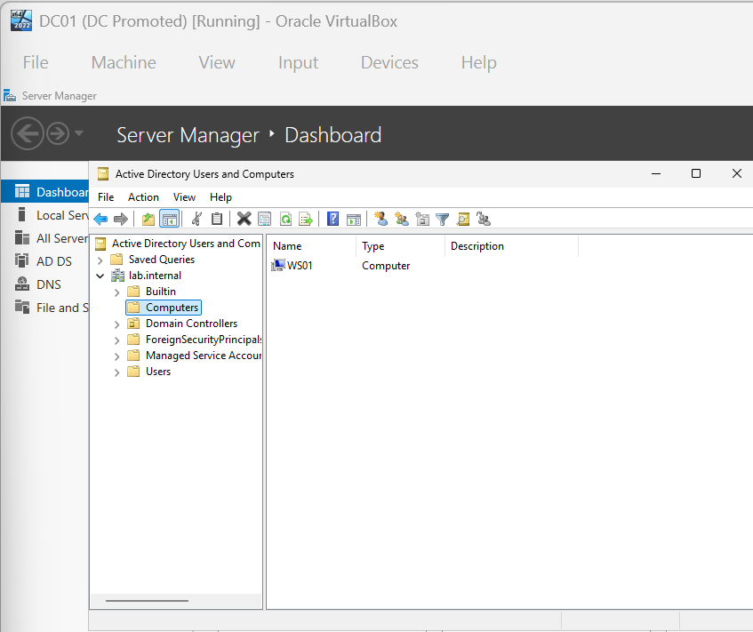
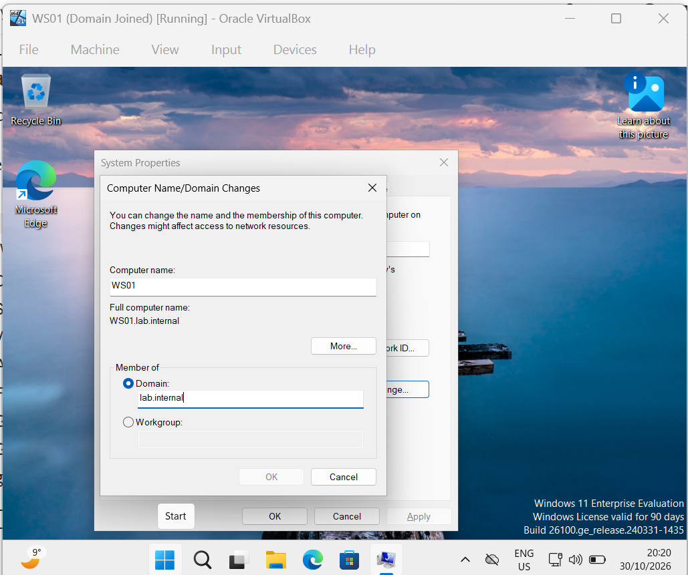

### Users, OUs and groups
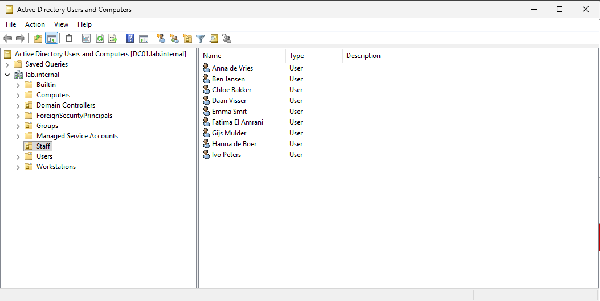
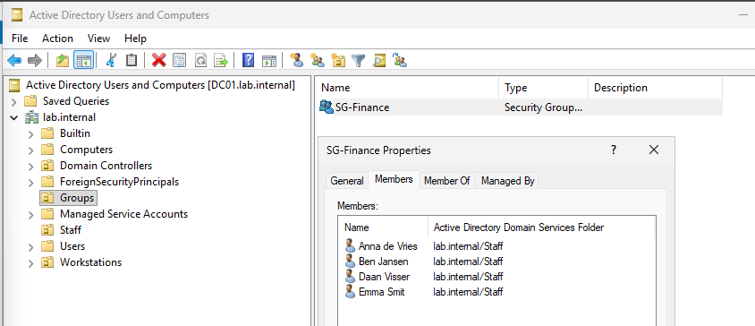

### Forced password change at logon
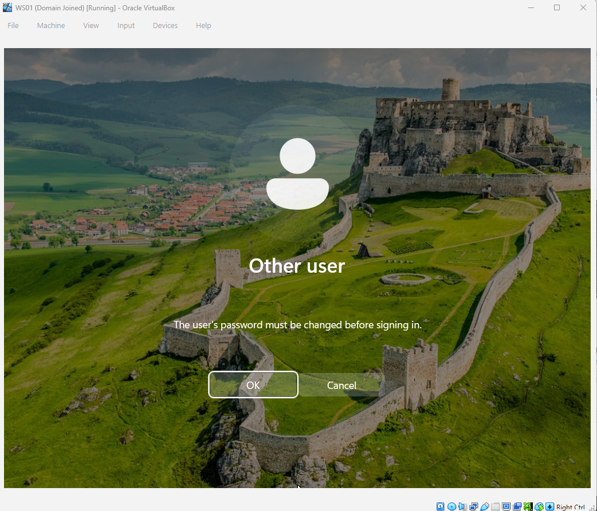
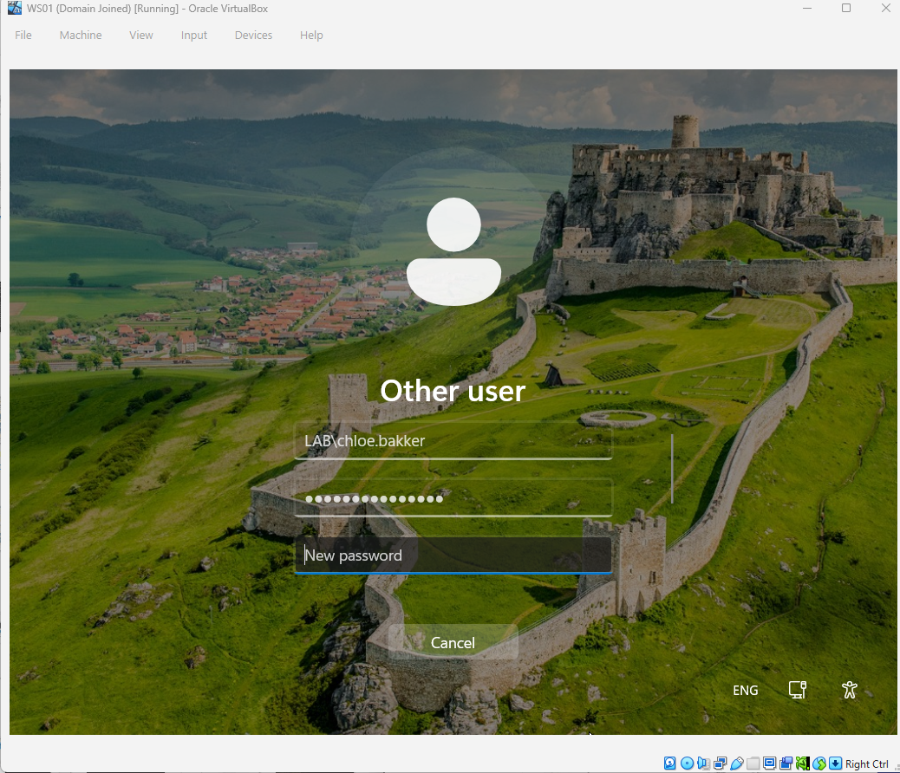

### Group Policy
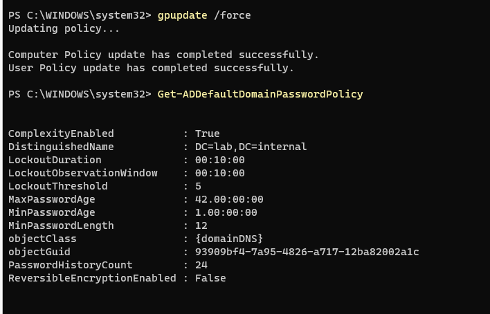
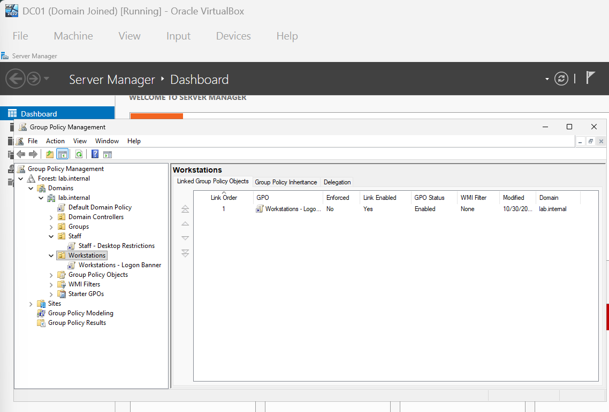
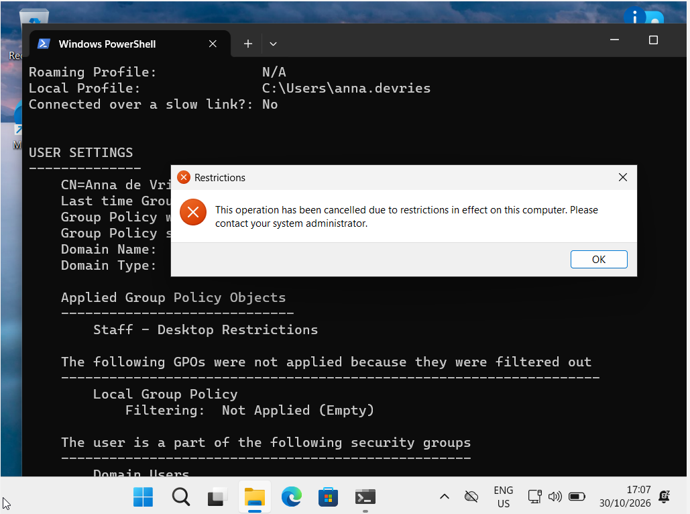
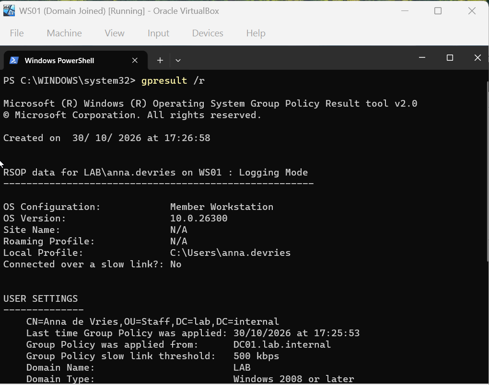
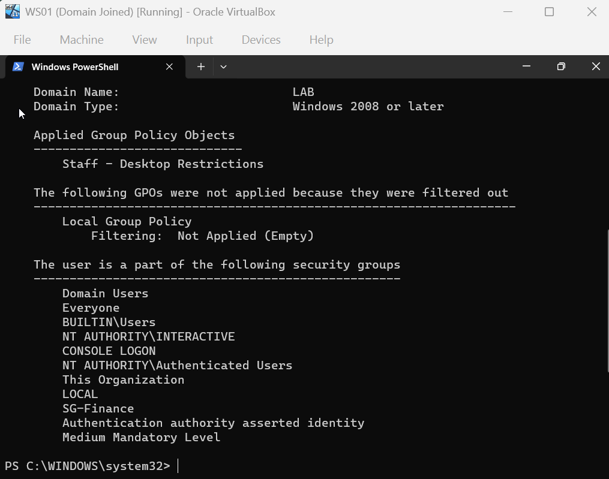

### Account lockout
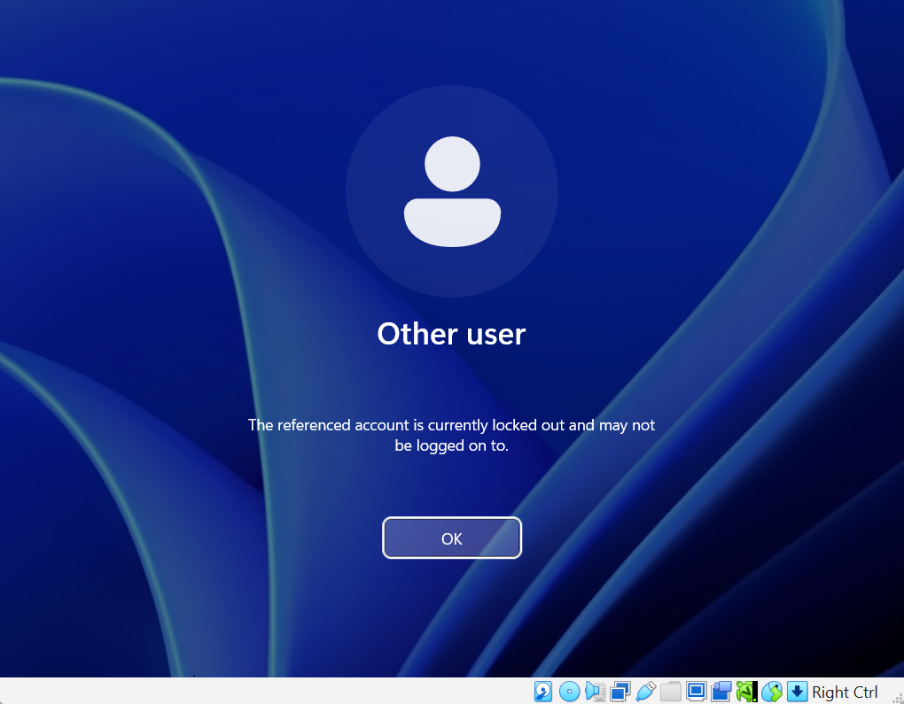
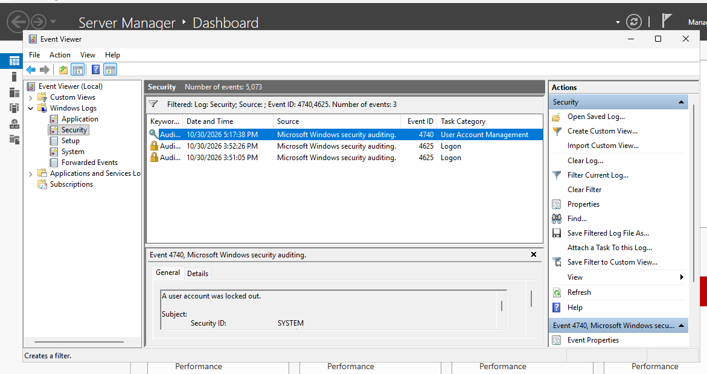

### PowerShell bulk user creation
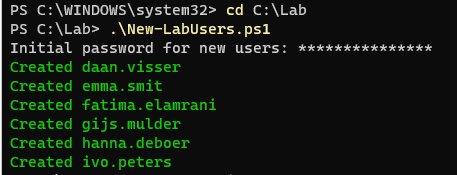
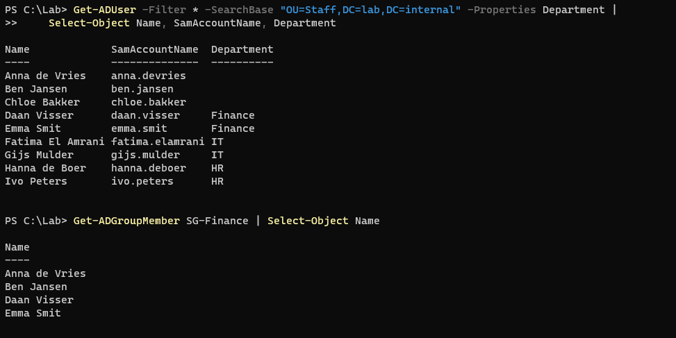

*Lab built on evaluation licences for learning purposes. All names and accounts are fictional.*
